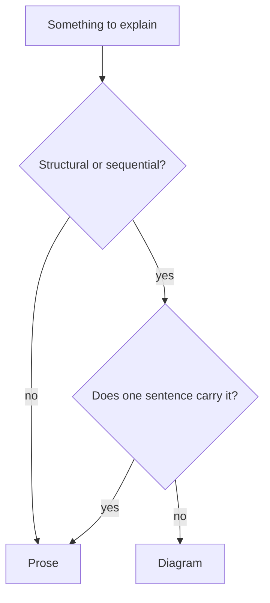

# Diagram style

How a diagram is written and checked, once [diagrams.md](diagrams.md) has settled that the
document needs one. The rule numbers here carry straight on from that file's, because both
get cited by number from source comments and from merged pull requests. Rules 13, 14, 16 and
19 apply inside a Mermaid block; the rest apply in any format.

## Rules

### Size and style

12. A diagram fits one screen: at most ~15 nodes, or ~8 participants in a sequence diagram.
    A larger one splits into several — and the document around it is probably over budget
    too. A committed image may run past that where the layout is the content, provided the
    docs site gives the reader a way to zoom it.
13. A Mermaid block declares its direction explicitly (`flowchart TD`, `flowchart LR`).
14. Every Mermaid block carries `accTitle` and `accDescr` as its first two lines. The
    rendered SVG tells a screen reader nothing, and the description is what every reader gets
    on the day the block fails to render:

15. Every edge is labelled with what crosses it (`Bot -->|session report| Queue`), never with
    `1`, `2`, or a bare `yes`.
16. In a Mermaid block, node IDs are short and stable, with the human-readable text in the
    label. A label containing `()`, `:`, `,`, or `#` is quoted — an unquoted special
    character is a parse error, and a parse error replaces the **whole** diagram with an
    error box.
17. `style` and `classDef` are not used for decoration. A docs site with light and dark
    themes makes hardcoded colours unreadable in one of them. Colour carries meaning only
    where the caption states that meaning in words. A committed image gets that restraint
    from [diagrams.md](diagrams.md) rule 5. A vendor's icon under rule 23 is the exception to
    hardcoded colours: it keeps its fixed colours, which are the vendor's and not a legend.
18. Diagrams count toward the document's 650-line limit, and no single block exceeds 60
    lines — see [document-sizing.md](document-sizing.md).

### Verification

19. Docs-site builds do not validate Mermaid. A syntax error passes the build and appears
    only as an error box in the browser, so a new or edited block is previewed — on the pull
    request page or in a local site build — before merging.
20. A new or edited committed image is checked on a local site build in both themes. A
    draw.io file is also reopened in draw.io to confirm the embedded copy survived, and a
    generated image is regenerated to confirm its source still produces it. The theme check
    covers a vendor's icon too: one that disappears against a background gets a surface
    behind it that works in both themes, since rule 23 rules out recolouring it. The build
    checks none of this.

### What a drawn layout carries

21. Every element of one of the five layouts [diagrams.md](diagrams.md) rule 2 names has a
    named explanation in the document beside it. A box nobody explains is the unlabelled
    fact rule 10 already describes, and the five are exactly the diagrams dense enough to
    hide one in.
22. Rule 14 is a Mermaid mechanism, and a committed image has no second one. What it carries
    instead is the alt text on the markdown image, which [diagrams.md](diagrams.md) rule 4
    already requires.
23. A diagram whose subject is cloud infrastructure, including the cloud architecture layout
    [diagrams.md](diagrams.md) rule 2 names, draws each cloud resource with the icon from its
    vendor's own published set, as that vendor's terms allow, because a reader who knows the
    console recognises its icon faster than a label. Each vendor's terms are its own and sit
    with its set: [Azure icons](https://learn.microsoft.com/en-us/azure/architecture/icons/),
    [AWS Architecture Icons](https://aws.amazon.com/architecture/icons/). The version is the
    one current when the diagram is drawn or next redrawn, so an existing diagram comes into
    line at its next redraw.
    - **Unmodified:** an icon is not cropped, flipped, rotated, distorted or recoloured.
    - **Named:** the product name sits beside the icon. An icon alone is an unlabelled fact,
      and rule 21's named explanation still applies to it.
    - **Embedded:** icons sit inside the image file, so it renders in an `` as
      [diagrams.md](diagrams.md) rule 4 requires. An SVG combining several keeps their
      internal `id`s unique, or one icon's gradients resolve to another's.
    - **Sourced:** a tool's built-in library counts as official only if it carries the
      vendor's current set; otherwise the icons come from the vendor's download.
    - **Left out:** the project's own workload is never drawn with a vendor's icon, because
      that icon stands for the vendor's product. A resource with no icon in the set stays a
      labelled box rather than a lookalike. A third-party service is outside this rule.

## Rationale

Rules 16 and 19 exist because Mermaid fails loudly and totally: one bad character costs the
reader the entire diagram, and nothing in CI will tell you.
