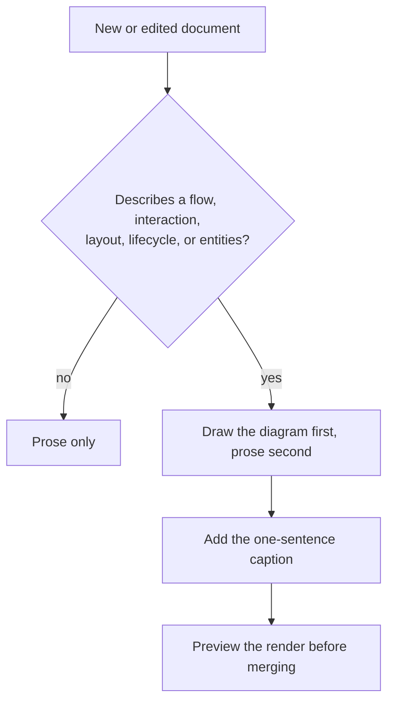

# Diagrams

When a document carries a diagram, and what a diagram achieves whatever it is made with. How
it is then written and checked is [diagrams-style.md](diagrams-style.md), which carries on
this file's rule numbering at 12 so no number means two things.

## Rules

### Any format, kept in the repository

1. A diagram takes the format that serves it: a fenced ` ```mermaid ` block, a hand-written
   or generated SVG, a draw.io export, a PNG, ASCII art, or anything else. Mermaid suits a
   flow well, since it renders on every major code host and in the common docs-site
   generators, and reviews as a text diff. What stays out is a link to an external
   diagramming tool standing in for the diagram. That is about where the diagram lives
   rather than what it is made with: one that is not committed is invisible to the change
   that makes it wrong, the reason [document-shape.md](document-shape.md) rule 1 gives.
2. Five layouts have grouping and placement that carry meaning, so each takes a format that
   controls both: an application's architecture, with the systems it talks to, its users,
   how each is authenticated and authorized, and where it is deployed; its tech stack; its
   AI agent map with the interactions and triggers between agents; a batch process's
   execution layout, with its trigger, cadence, what triggers it, where it runs, and what it
   reads and writes; and the cloud architecture. A cadence or trigger is a label on the
   drawing; the exact schedule stays in the file that runs it and is linked from the prose
   beside it. A batch run's own steps are a flow, and no part of its layout.
3. Screenshots of real UI are not diagrams, and remain allowed as illustrations.

### Committing an image

A *committed image* is a diagram kept as a file the document links, whatever produced it. A
diagram written inside the markdown, as a fenced block, is not one.

4. The file lives in the images folder the project already uses, and the markdown image
   carries alt text saying what the diagram shows. It is self-contained: an SVG in an ``
   cannot load external files, fonts or scripts, so what it needs is inside it. It has one
   source of truth. A file that is its own source, such as a hand-written SVG, needs nothing
   more; otherwise the source is embedded in the file, or committed beside it along with how
   to regenerate it. An export whose source is lost can only be replaced, and one that has
   drifted from its source is invisible because the document still reads correctly. In a
   draw.io export the embedded source comes from checking **Include a copy of my diagram**,
   which writes the XML into a `<name>.drawio.svg` that reopens in draw.io — or in an
   editor's draw.io extension — to re-save in place.
5. The diagram is legible in both site themes. In an SVG, `color-scheme: light dark` and
   `light-dark()` pairs carry both in one file, with light as the fallback below Chrome 123,
   Firefox 120, and Safari 17.5. A draw.io export gets those from **Appearance: Automatic**,
   with the page's adaptive colour mode (Page Setup) also Automatic. A raster image has a
   background that works in both.
6. Those pairs track the **site's** theme, not the operating system's, wherever the
   docs-site theme sets a computed `color-scheme` on `<body>` — an `` inherits it, so
   the toggle in the header moves the diagram with the page. Worth verifying in a browser
   across all four combinations of OS and site theme: a theme that stopped declaring
   `color-scheme` would hand the choice back to the OS.

### When a diagram is required

The gate every document passes through, and what follows once a diagram is required:



7. A document carries at least one diagram where it describes any of: a multi-step flow, a
   request/response interaction between components, an architecture or component layout, a
   lifecycle or status machine, or relationships between stored entities.
8. A numbered list of steps involving more than one actor is a sequence diagram instead.
9. The diagram comes first and the prose second, carrying only what the diagram cannot —
   exact names, error codes, thresholds, and the reasons behind a decision.
10. One sentence saying what the diagram shows immediately precedes it. A diagram with no
    caption is an unlabelled fact, and prose that restates the diagram is the paragraph it
    replaced, back again — the caption says what the reader is looking at, not what is in
    it.

### Choosing the diagram type

| Content | Suggestion, in Mermaid's names where it has one |
|---|---|
| A process with branches or decisions | `flowchart TD` |
| Components exchanging messages over time | `sequenceDiagram` |
| Status values and the transitions between them | `stateDiagram-v2` |
| Containers, entities, and their relationships | `erDiagram` |
| Type or class hierarchies | `classDiagram` |
| A layout whose grouping and placement carry meaning | a format that controls them |

11. A Gantt chart or a timeline is not drawn, in any format. Dated diagrams go stale silently.

## Rationale

Rule 7 is the point of this file. Most documents describe something moving through the
system — a message through a pipeline, a session through report generation, a user through
sign-in — and those are read far faster as a picture than as prose.
