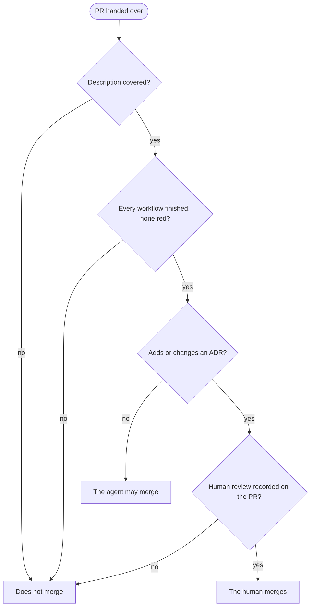

# Reviewing and merging a PR

What a pull request satisfies before it merges, and which pull requests a human merges.

[From board to reviewed PR](board-to-pr.md) ends at the handover to a human. From there a
PR merges when three conditions hold together: its description is covered item by item,
every workflow on its head commit has finished and none is red, and any ADR it carries has
been reviewed by a human. An approval stands in for none of the three.

## The description is covered

A PR description carries up to three sections a merge has to account for. They are named
here by what they do — the *test plan*, the *questions for the author*, and the *runbook*.
A project's own headings differ (*Questions for polikeiji*, *Deploy*, *Production*), and
the rule follows the section's job rather than its heading. Every item in each is covered
before the merge, and covered has a different meaning in each.

### Test plan

Every box is checked, and only because that check ran and passed. A box ticked to clear the
way is worse than one left empty, for the reason [From board to reviewed PR](board-to-pr.md)
gives. A box that cannot be ticked stops the merge.

A check that is dropped rather than run is struck through with the reason beside it, never
left unchecked or checked anyway:

> - [x] ~~Seed the staging tenant and sign in as a viewer~~ — staging is retired; covered by
>   the viewer-role e2e case above

An unchecked box reads as work still owed, and a checked one as work done, so a dropped
check written as either tells the next reader something false.

### Questions for the author

Every question has an answer recorded on the PR — a reply, or an edit to the description
that answers it. A question answered somewhere else, in a chat or a call, is not covered:
the PR is where a later reader looks for why the change went the way it did, and an answer
that never reached it is one they cannot find.

### Runbook

Every step that belongs before the merge is done and recorded on the PR as done. A step
that can only follow the merge — *dispatch the deploy after merge* — cannot be done first,
so it is covered when the person merging has seen it and will run it. That acknowledgement
is recorded on the PR too; a post-merge step nobody claimed is the one that does not run.

## Every workflow has finished, none red

Every workflow run on the PR's head commit has completed. *Queued* and *in progress* are not
finished, and the merge waits for them, because a run still going is a result nobody has
seen yet.

A failed, timed-out or cancelled run is red. A cancelled run is no evidence the check would
have passed, so it is re-run rather than read as neutral. A run cancelled because a newer
push superseded it sits on an older commit and is out of scope; only the head commit's runs
count. A run or job skipped by a path filter or a stack gate is not red, the same reading
[Writing a workflow](../ci-cd/writing-a-workflow.md) gives a skipped job.

A red run is fixed, or re-run until it is green, and never merged past. A flaky run that
passes on re-run is still noted on the PR, with the run that failed, since a flake nobody
recorded is the one that keeps costing re-runs.

This covers every workflow, not only those branch protection marks required. The required
list is a floor GitHub enforces, and a workflow left off it still reports something the
merge would otherwise ignore.

## An ADR is reviewed by a human

A PR that adds or changes a file under the project's ADR directory does not merge without a
human's review of that ADR. An ADR binds every change after it, and the decision it records
is the human's to accept, not the agent's that wrote it.

On a single-maintainer project the agent works under the maintainer's account, so the human
is also the PR's author on GitHub, and GitHub does not let an author approve their own pull
request. The review is recorded instead as a review or comment from the human on the PR
saying the ADR was read and accepted, and the human merges the PR. A project with a second
reviewer uses its ordinary approval, and the human merge still applies.

## Who merges

The agent may merge a PR only when the description is covered, every workflow on the head
commit has finished green, and the PR carries no ADR. Every other PR is merged by a human.

## Done

The merge is what moves the ticket to *Done*, through the status flow in
[From board to reviewed PR](board-to-pr.md#status).
